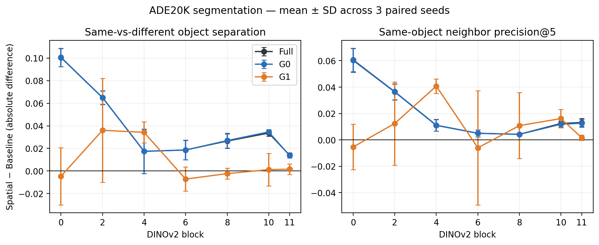
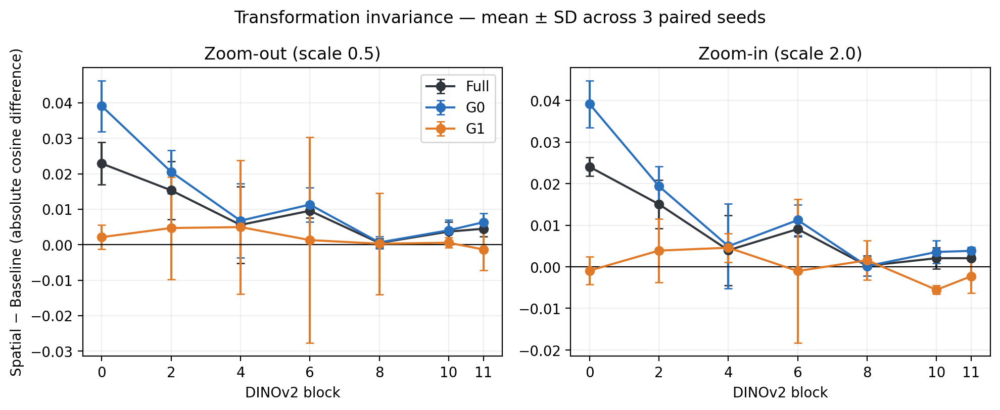

# T-SAE Follow-Up: Spatial SAE Study

Research code and final three-seed results for grouped Matryoshka sparse
autoencoders (SAEs) trained on frozen DINOv2 patch representations. The
**Spatial SAE** adds a local contrastive objective to the reconstruction and
Matryoshka losses; the matched **baseline** uses the same architecture and
training pipeline with zero spatial loss weight.

The main models use a 16,384-feature dictionary on a 16×16 patch grid. The
first Matryoshka group (`G0`, 3,276 features) is trained as the reconstruction
prefix; `G1` contains the remaining features. `Full` refers to all latent
dimensions.

> **Reproducibility status:** this is a research-code snapshot, not a
> self-contained installable package. Several scripts depend on the original
> `T-SAE-Spatial` / `temporal-saes` codebase, trained checkpoints, datasets,
> and hard-coded cluster paths. Checkpoints and datasets are not committed.

## Key findings

- **The spatial objective improves object-level structure in the SAE code.**
  On ADE20K at DINOv2 block 0, same-vs-different object separation rises from
  0.184 to 0.284 (+55% relative), and same-object neighbor precision@5 from
  0.742 to 0.802 (+8%). All three seeds agree in sign at every block for the
  Full and G0 codes.
- **The gain lives in G0.** Full-code and G0 curves are nearly identical,
  while G1 alone has much lower absolute performance and no stable Spatial
  advantage.
- **The effect is strongest in early layers** (blocks 0–2) and shrinks, but
  mostly stays positive, in later blocks.
- **Zoom invariance improves; rotation and flip invariance do not.** G0
  zoom-out and zoom-in invariance improve by +24% and +39% at block 0, whereas
  the Spatial SAE is equal or slightly worse under rotation and horizontal
  flipping.

## Results

All comparisons pair Spatial and baseline checkpoints within each of three
training seeds and cover DINOv2 blocks 0, 2, 4, 6, 8, 10, and 11. Error bars
are the standard deviation of the three paired seed differences. Positive
values always mean Spatial minus baseline; relative percentages are
`(Spatial − Baseline) / |Baseline|`.

### ADE20K segmentation



G0 code, Spatial vs. baseline (mean of 3 seeds; `p` is the seed-paired t-test, `n=3`):

| Block | Separation: Spatial | Baseline | Δ | p | Precision@5: Spatial | Baseline | Δ | p |
|---:|---:|---:|---:|---:|---:|---:|---:|---:|
| 0  | 0.286 | 0.185 | **+0.101** | 0.002 | 0.803 | 0.743 | **+0.060** | 0.007 |
| 2  | 0.240 | 0.175 | **+0.065** | 0.003 | 0.812 | 0.775 | **+0.036** | 0.009 |
| 4  | 0.250 | 0.233 | +0.017 | 0.26  | 0.803 | 0.792 | +0.011 | 0.049 |
| 6  | 0.286 | 0.267 | +0.019 | 0.065 | 0.803 | 0.798 | +0.005 | 0.083 |
| 8  | 0.293 | 0.266 | +0.027 | 0.019 | 0.796 | 0.792 | +0.004 | 0.008 |
| 10 | 0.274 | 0.240 | +0.035 | 0.001 | 0.780 | 0.768 | +0.012 | 0.012 |
| 11 | 0.289 | 0.275 | +0.014 | 0.009 | 0.772 | 0.760 | +0.013 | 0.019 |

Label propagation follows the same pattern: at block 0, G0 nearest-neighbor
propagation accuracy improves from 0.405 to 0.450 with 1 label per class and
from 0.661 to 0.718 with 8 labels per class; by block 6 the difference is
essentially zero.

### Transformation invariance



G0 image-level code cosine similarity between original and transformed images:

| Block | Zoom-out (×0.5): Spatial | Baseline | Δ | Zoom-in (×2): Spatial | Baseline | Δ |
|---:|---:|---:|---:|---:|---:|---:|
| 0  | 0.202 | 0.163 | **+0.039** | 0.139 | 0.100 | **+0.039** |
| 2  | 0.236 | 0.215 | +0.021 | 0.129 | 0.110 | +0.019 |
| 4  | 0.298 | 0.291 | +0.007 | 0.156 | 0.151 | +0.005 |
| 6  | 0.338 | 0.327 | +0.011 | 0.197 | 0.186 | +0.011 |
| 8  | 0.357 | 0.356 | +0.001 | 0.209 | 0.208 | +0.000 |
| 10 | 0.372 | 0.368 | +0.004 | 0.227 | 0.223 | +0.004 |
| 11 | 0.424 | 0.417 | +0.006 | 0.274 | 0.270 | +0.004 |

The effect does not generalize to rotation (90°/180°/270°) or horizontal
flipping: at block 0, G0 invariance under these transforms is 0.015–0.028
lower for the Spatial SAE, and later blocks show differences near zero.

### Figures and data

| Task | Absolute Spatial − Baseline | Relative improvement |
|---|---|---|
| Segmentation | [`segmentation_absolute.png`](figures/downstream_3seed/segmentation_absolute.png) | [`segmentation_relative_percent.png`](figures/downstream_3seed/segmentation_relative_percent.png) |
| Zoom invariance | [`transformation_absolute.png`](figures/downstream_3seed/transformation_absolute.png) | [`transformation_relative_percent.png`](figures/downstream_3seed/transformation_relative_percent.png) |

Exact paired-seed values, standard deviations, p-values, and sign-agreement
flags for every block, group, and metric are in
[`results/segmentation_groupwise_3seed_summary.csv`](results/segmentation_groupwise_3seed_summary.csv)
and
[`results/transformation_invariance_3seed_summary.csv`](results/transformation_invariance_3seed_summary.csv).
Regenerate all four figures from these summaries with:

```bash
python figures/plot_groupwise_downstream_3seed.py
```

No multiple-comparison correction is applied; read individual p-values
together with the three-seed uncertainty and the complete blockwise curves.

## Repository map

| Location | Contents |
| --- | --- |
| [`training/`](training/) | Main DINOv2 Matryoshka SAE trainer, multiscale/independent-group variant, and grouped TopK SAE implementation. |
| [`downstream_tasks/`](downstream_tasks/) | Groupwise segmentation and propagation, transformation invariance, cross-view correspondence, and direct spatial-code controls. |
| [`mechanistic_analysis/`](mechanistic_analysis/) | Channel energy, low-rank participation, G0 routing, reconstruction quality (FVU), PCA structure, and channel whitening; multiblock scripts cover the same seven blocks. |
| [`synthetic/`](synthetic/) | Smooth/rough factor generators, paired SAE training, recovery and routing analyses, and energy/low-rank shortcut interventions. |
| [`results/`](results/) | Final three-seed summary CSVs used by the plotting script. |
| [`figures/`](figures/) | Final downstream figures (`downstream_3seed/`), plus smoothness and direct-objective control figures and their plotting scripts. |
| [`slurm/`](slurm/) | SLURM launchers. |
| [`utils/`](utils/) | Checkpoint-specific feature preprocessing and GPU/reproducibility checks. |

Useful entry points:

| Goal | Script |
| --- | --- |
| Train a DINOv2 Spatial / baseline SAE | [`training/new_spatial_train.py`](training/new_spatial_train.py) |
| Train the multiscale/independent-group variant | [`training/train_multiscale_spatial_independent_subsae.py`](training/train_multiscale_spatial_independent_subsae.py) |
| Full/G0/G1 ADE20K segmentation and propagation for one block/seed | [`downstream_tasks/segmentation_groups_eval.py`](downstream_tasks/segmentation_groups_eval.py) |
| Aggregate the 21 block/seed cells across seeds | [`downstream_tasks/aggregate_segmentation_groups.py`](downstream_tasks/aggregate_segmentation_groups.py) |
| Full/G0/G1 rotation, flip, crop, and zoom invariance | [`downstream_tasks/transformation_invariance.py`](downstream_tasks/transformation_invariance.py) |
| ADE20K instance masks and alignment metrics | [`downstream_tasks/segment_alignment.py`](downstream_tasks/segment_alignment.py) |
| Cross-view patch localization | [`downstream_tasks/two_view_correspondence.py`](downstream_tasks/two_view_correspondence.py) |
| Within-image smoothness against a mosaic null | [`downstream_tasks/code_smoothness_same_vs_across.py`](downstream_tasks/code_smoothness_same_vs_across.py) |
| Training-aligned positive/negative similarities | [`downstream_tasks/code_contrastive_direct_eval.py`](downstream_tasks/code_contrastive_direct_eval.py) |
| Batch-random negative control | [`downstream_tasks/code_smoothness_batch_random.py`](downstream_tasks/code_smoothness_batch_random.py) |
| Reconstruction quality | [`mechanistic_analysis/fvu_compare.py`](mechanistic_analysis/fvu_compare.py), [`mechanistic_analysis/eval_fullcode_fvu_multiblock.py`](mechanistic_analysis/eval_fullcode_fvu_multiblock.py) |
| Synthetic training and recovery | [`synthetic/train_synth_spatial.py`](synthetic/train_synth_spatial.py), [`synthetic/analyze_synth_recovery.py`](synthetic/analyze_synth_recovery.py) |

## Environment and external dependencies

Principal dependencies are PyTorch, torchvision, NumPy, pandas, SciPy,
scikit-learn, Pillow, matplotlib, Hugging Face `datasets`, PyArrow, joblib,
einops, and DINOv2 dependencies. No pinned environment or lockfile is
included.

The following project modules are imported but are **not supplied here**:

- `dictionary_learning`, including `trainers.temporal_sequence_top_k` and,
  for synthetic training, `trainers.temporal_sequence_top_k_weight`;
- `new_vision_patch_pairs`;
- `new_spatial_train_triplet`;
- `channel_transform` and `prenorm_scale_check`;
- `synth_topk_gen` for the toy shortcut experiments.

`training/temporal_sequence_top_k.py` is a trainer source file with
package-relative imports; it does not install `dictionary_learning`.

Expose the local helpers and external modules on `PYTHONPATH`:

```bash
git clone https://github.com/Semi-entirety/T-SAE-Follow-Up.git
cd T-SAE-Follow-Up

STUDY_ROOT="$PWD"
EXTERNAL_ROOT=/absolute/path/to/T-SAE-Spatial
export PYTHONPATH="$STUDY_ROOT/downstream_tasks:$STUDY_ROOT/mechanistic_analysis:$STUDY_ROOT/utils:$STUDY_ROOT/synthetic:$EXTERNAL_ROOT/scripts:$EXTERNAL_ROOT/temporal-saes/dictionary_learning:${PYTHONPATH:-}"
```

Then search the scripts for `/n/home12/`, `/n/holylfs06/`, `/n/holylabs/`,
and `/home/ubuntu/` and update cache, data, checkpoint, and output locations.
Some modules set `TORCH_HOME` / `HF_HOME` or prepend project paths to
`sys.path` at import time, so exporting environment variables alone is not
enough.

## Data and checkpoints

Depending on the experiment, provide:

- DINOv2's local torch.hub source/cache and model weights;
- held-out image Parquet files with an `image` column of image bytes;
- ADE20K instance annotations (`1aurent/ADE20K`) for segmentation and
  propagation;
- matching Spatial/baseline checkpoints (commonly `ae_latest.pt`) for each
  seed, with the adjacent `run_args.json` when using `utils/arm_pipeline.py`;
- `ground_truth.npz` and run metadata for synthetic recovery, produced by
  synthetic training.

Match the backbone, block, normalization, input scale, and image size to each
checkpoint's training convention.

## Example workflows

### Final groupwise segmentation (7 blocks × 3 seeds)

```bash
# One block/seed cell
python downstream_tasks/segmentation_groups_eval.py \
  --block 0 --seed 0 --max_seg 500 --max_prop 300 \
  --outdir results/raw_segmentation_groups/b0_s0

# Or all 21 cells as a SLURM array (override PY / OUT_ROOT as needed)
sbatch slurm/run_segmentation_groups_eval.sbatch

# Paired three-seed aggregation
python downstream_tasks/aggregate_segmentation_groups.py \
  --raw_root results/raw_segmentation_groups \
  --out results/segmentation_groupwise_3seed_summary.csv
```

### Transformation invariance

```bash
python downstream_tasks/transformation_invariance.py \
  --parquet /absolute/path/to/heldout_images.parquet \
  --ckpt /absolute/path/to/ae_latest.pt \
  --dino_block 0 --n_images 200 --device cuda \
  --outdir results/transformation_invariance_b0
```

### Direct smoothness: Spatial versus baseline

```bash
python downstream_tasks/code_smoothness_same_vs_across.py \
  --ckpt spatial:/absolute/path/to/spatial/ae_latest.pt \
  --ckpt baseline:/absolute/path/to/baseline/ae_latest.pt \
  --dino_block 0 \
  --parquet /absolute/path/to/heldout_images.parquet \
  --n_images 200 --null_reps 10 --n_boot 5000 --n_perm 100000 \
  --device cuda --outdir results/code_smoothness_b0
```

The mosaic null preserves patch position and latent marginals while breaking
within-image coherence. Positive effects indicate greater within-image
smoothness under the chosen metric (cosine, Fourier, wavelet, multiscale, or
Lipschitz/local variation).

### Synthetic training and recovery

```bash
python synthetic/train_synth_spatial.py \
  --save_dir results/synth_spatial_s0 --seed 0 --data_seed 0 --device cuda

python synthetic/analyze_synth_recovery.py \
  --ckpts spatial=results/synth_spatial_s0/ae_latest.pt \
  --outdir results/synth_recovery --device cuda
```

### SLURM

Before submitting a launcher, edit its account/partition, log destinations,
Python executable, and data/checkpoint/output paths. Older launchers retain
their original cluster paths and may invoke scripts from a flat directory, so
update the script paths to `downstream_tasks/`, `mechanistic_analysis/`, or
`synthetic/` as appropriate.

## Statistical conventions

- Spatial and baseline checkpoints are paired by training seed and evaluated
  on identical images and patch-label draws.
- Seed-level tests (`n=3`) measure reproducibility across training runs.
- Item-level paired tests and image-bootstrap intervals, when present in raw
  outputs, measure reliability for one checkpoint pair and are not substituted
  for seed uncertainty.
- FVU implementations differ across scripts (squared-error vs.
  residual-variance conventions); compare values only under the same
  definition.
